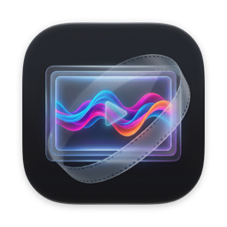
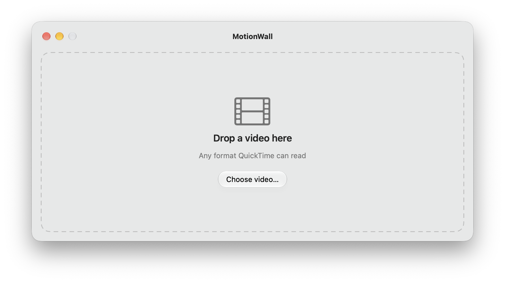
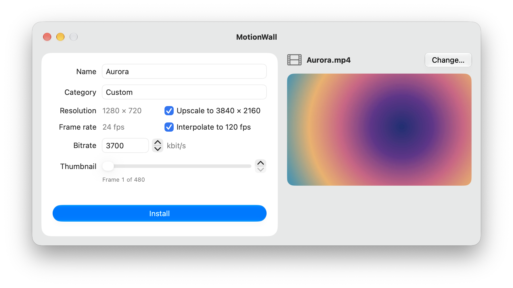
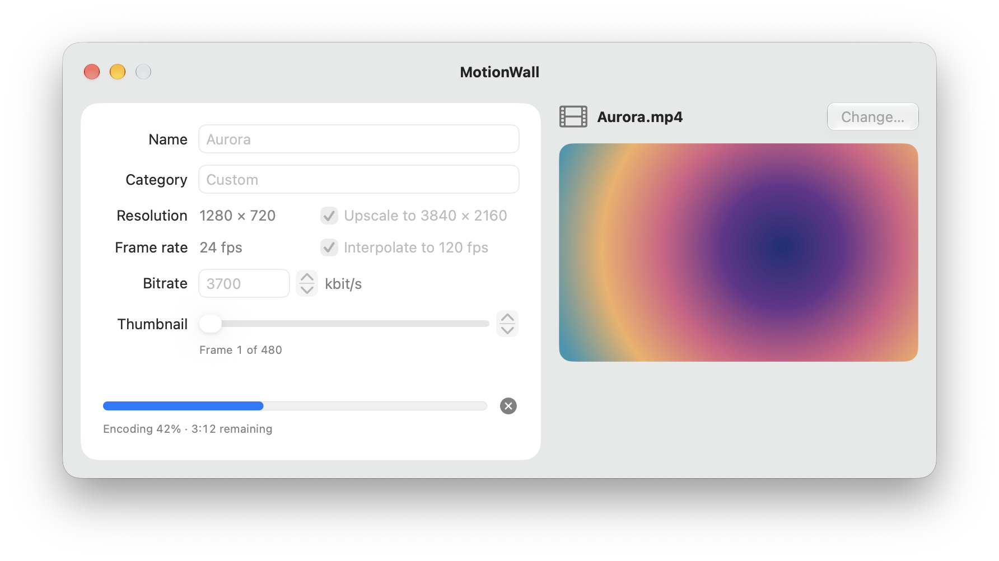

<p align="center">
  
</p>

<h1 align="center">MotionWall</h1>

<p align="center">Turn any video into a macOS animated wallpaper and install it into System Settings → Wallpaper.</p>

MotionWall is a Mac app that turns a video into a wallpaper you pick in System Settings, like Apple's own aerials. It encodes the video the way macOS needs it, can upscale it to 4K and smooth it to 120 fps on the way, makes the thumbnail tile, and adds the wallpaper to your library. A command-line tool inside the app does the same job for scripts.

## The app

Open MotionWall and drop a video on the window, or press Choose video…. Any format QuickTime can read works.

<p align="center"></p>

Once the video is in, the left side holds the settings and the Install button, and the right side shows the thumbnail tile:

<p align="center"></p>

- **Name** and **Category** are what System Settings shows. The name starts as the file name, the category as `Custom`.
- **Resolution** is the source's; the aspect ratio never changes. **Upscale**, on by default, enlarges the video 4× with VideoToolbox super resolution and fits the result within 4K (3840×2160), so 480p ends at 1920 lines and 720p or 1080p at 2160. It needs macOS 26, is offered for sources up to 1920×1080, and downloads Apple's model the first time. A source larger than 4K is shrunk to fit.
- **Frame rate** is the source's. MotionWall keeps every frame. **Interpolate to 120 fps**, on by default, adds frames in between with VideoToolbox frame rate conversion for a smoother unlock. It needs macOS 15.4 or later and is hidden when the source already runs at 120 fps or the Mac does not support it.
- **Bitrate**, in kbit/s, starts at the source's bitrate converted to HEVC, raised for upscaling and for 120 fps. Ticking either box updates the field unless you typed your own value. [Docs/encoder.md](Docs/encoder.md) has the math.
- **Thumbnail** picks the frame used for the tile. The preview on the right is the exact 642×390 image that gets installed.

To swap videos, drag another one over the window. Before you let go, it shows that file's name, size, frame rate and bitrate. Change… on the right does the same through a file picker.

Install turns into a progress bar with the time remaining. Its ✕, closing the window, or quitting asks before stopping the install, and the encode pauses while the question is open. It asks before replacing one of your own wallpapers.

<p align="center"></p>

Upscaling and 120 fps take time: a 41-second 720p clip with both on encodes in about 12 minutes on an M5.

When the install is done, a dialog offers **Use as Wallpaper**, **Open Wallpaper Settings** and **Done**. **Use as Wallpaper** switches every screen and Space whose wallpaper is already an animated one (an aerial) to the new video, and does the same for the screen saver when it shows an aerial. macOS has no public API for this, so MotionWall edits the wallpaper store, `~/Library/Application Support/com.apple.wallpaper/Store/Index.plist`, restarts `WallpaperAgent`, and checks that the change held. When the current wallpaper is a picture or another kind, or macOS rejects the change, it says so and offers Wallpaper settings instead.

The window follows the system's light and dark appearance, and uses Liquid Glass on macOS 26 and later.

The app is not sandboxed: it writes into `~/Library/Application Support/com.apple.wallpaper` and restarts `WallpaperAgent`, and the sandbox forbids both.

## Install

You need macOS 13 or later and a Mac with a hardware HEVC encoder. Every Apple silicon Mac has one. So does any Intel Mac with Quick Sync. MotionWall checks for it and stops with a clear message when it is missing. Interpolating to 120 fps needs macOS 15.4, and upscaling needs macOS 26.

1. Download `MotionWall-<version>.zip` from the [latest release](https://github.com/romulof/MotionWall/releases/latest).
2. Unzip it and move `MotionWall.app` to `/Applications`.
3. Open it once. Because the app is not notarized by Apple, macOS refuses to open it and shows a warning that it cannot check the app.
4. Open System Settings → Privacy & Security, scroll to Security, and click **Open Anyway** next to the message about MotionWall. Confirm with your password. The button stays there for about an hour after the refused launch; if it is gone, open the app again first.

From then on MotionWall opens normally. On macOS 13 and 14 you can instead Control-click the app in Finder, choose Open, and confirm.

If you prefer the Terminal, removing the download quarantine flag does the same:

```
xattr -dr com.apple.quarantine /Applications/MotionWall.app
```

To remove MotionWall, delete the app, and the CLI link if you made one. Wallpapers you already installed stay in place.

## Build from source

You need Xcode 26 or later:

```
git clone git@github.com:romulof/MotionWall.git
cd MotionWall
xcodebuild -project MotionWall.xcodeproj -scheme MotionWall -configuration Release -derivedDataPath .build/xcode build
cp -R .build/xcode/Build/Products/Release/MotionWall.app /Applications/
```

Or open `MotionWall.xcodeproj` and press Run. An app you build yourself is not quarantined, so it opens without the steps above.

## The CLI

The CLI ships inside the app at `MotionWall.app/Contents/Helpers/motionwall`. It sits in `Helpers` rather than `MacOS` because `motionwall` and the app's own `MotionWall` executable would be the same file on a case-insensitive volume. Put it on your PATH with a link:

```
sudo ln -s /Applications/MotionWall.app/Contents/Helpers/motionwall /usr/local/bin/motionwall
```

Link it rather than copying it: it loads `libMotionWallCore.dylib` from the app's `Contents/Frameworks`, so a copy outside the app cannot start.

```
motionwall --input <path> --name <name> [options]
```

| Flag | Required | Default | Meaning |
|---|---|---|---|
| `--input <path>` | yes | — | Source video. Any format AVFoundation can read. |
| `--name <name>` | yes | — | Wallpaper name shown in System Settings. |
| `--category <name>` | no | `Custom` | Section name in the wallpaper list. |
| `--thumbnail-frame <n>` | no | `1` | 1-based frame used for the tile image. |
| `--width <pixels>` | no | source width | Output width. Scaled with Lanczos. |
| `--height <pixels>` | no | source height | Output height. |
| `--bitrate <kbps>` | no | source bitrate, converted to HEVC | Target bitrate in kbit/s, at least `100`. See [Docs/encoder.md](Docs/encoder.md). Falls back to `12000` when the source does not report one. |
| `--upscale` | no | off | Enlarge 4× with VideoToolbox super resolution and fit within 3840×2160, as the app's Upscale does. Needs macOS 26 and a source up to 1920×1080. |
| `--interpolate` | no | off | Interpolate to 120 fps with VideoToolbox frame rate conversion, as the app's option does. Needs macOS 15.4; skipped for a source already at 120 fps. |
| `--force` | no | off | Replace an existing wallpaper without asking. |

Unlike the app, the CLI lets width and height scale independently, so setting only one stretches the picture. With `--upscale`, they set the final size the 4× result is scaled to. Both VideoToolbox options are off unless you pass them, and the default bitrate rises with them as in the app.

Example:

```
motionwall --input video.mp4 --name "My Wallpaper" --width 3840 --height 2160 --thumbnail-frame 200
motionwall --input clip-720p.mov --name "Smooth" --upscale --interpolate
```

## What it does

1. Reads the source and scales it with `CILanczosScaleTransform`.
    With Upscale (`--upscale`), VideoToolbox super resolution enlarges each frame 4× first; with 120 fps (`--interpolate`), VideoToolbox frame rate conversion interpolates the scaled frames onto a 120 fps grid. [Docs/encoder.md](Docs/encoder.md) has the details.
2. Encodes HEVC Main 10 through `VTCompressionSession`, with temporal layers.
3. Extracts the chosen frame, centre-crops it to the 642×390 tile aspect.
4. Copies both files into `~/Library/Application Support/com.apple.wallpaper/aerials/`.
5. Adds or replaces the entry in `manifest/entries.json`, then restarts `WallpaperAgent`. When the manifest bundled with macOS has a newer `version`, MotionWall first rebuilds the file from it and carries your own categories and wallpapers over, because the wallpaper selector ignores an older downloaded manifest.

Output has no audio track. Apple's aerials have none either.

The temporal layers in step 2 are what make the unlock animation work. See [Docs/temporal-layers.md](Docs/temporal-layers.md) for why, and for why `ffmpeg` cannot produce such a file.

## Safety

- Apple categories are refused. A category is Apple's when its id is `dynamic-aerials` or its name key starts with `AerialCategory`. Both the raw key (`AerialCategoryLandscapes`) and the display name (`Landscapes`) are matched.
- Apple assets are refused. An asset is Apple's when its video URL is not `file://`.
- Replacing one of your own wallpapers asks first, in the app and in the CLI. `--force` skips the question in the CLI.
- `manifest/entries.json` is copied to `entries.json.bak` before the first write, and `Store/Index.plist` to `Index.plist.bak` before Use as Wallpaper first changes it.

## Project layout

| Path | What it is |
|---|---|
| `Sources/MotionWallCore` | The encoder, thumbnail maker and wallpaper library code, built as `libMotionWallCore.dylib`, which the app and the CLI share. |
| `Sources/MotionWallCli` | The `motionwall` command-line tool. |
| `Sources/MotionWallApp` | The SwiftUI app, including the `AppIcon.icon` app icon. |
| `Design` | Source artwork for the icon. |
| `Docs` | Background reading and the README's screenshots. |

## Contributing

Commit messages and PR titles follow [Conventional Commits](https://www.conventionalcommits.org): `<type>(<scope>)!: <description>`, with type one of `build`, `chore`, `ci`, `docs`, `feat`, `fix`, `perf`, `refactor`, `revert`, `style` or `test`. On every pull request and every push to `main`, CI checks the commit messages, and a pull request's title, and builds the app with Xcode.

Releases are cut from those messages. On every push to `main`, [release-please](https://github.com/googleapis/release-please) keeps a release PR open with the next version and the changelog: `fix` bumps the patch, `feat` the minor, and `!` marks a breaking change. Merging that PR tags the release, publishes its notes, and attaches the built `MotionWall-<version>.zip`. `scripts/build-app.sh` is the build both workflows run.

## Docs

- [The encoder](Docs/encoder.md) — the upscale and interpolation pipeline, the output resolution rule, and the codec, resolution and frame-rate factors behind the default bitrate, with the measurements they come from.
- [Why temporal layers matter](Docs/temporal-layers.md) — the HEVC sample groups macOS needs for the unlock animation, why the desktop goes black without them, why `ffmpeg` cannot write them, and which video properties turned out to be irrelevant.

## Licence

GPL v3. See [LICENSE](LICENSE).
